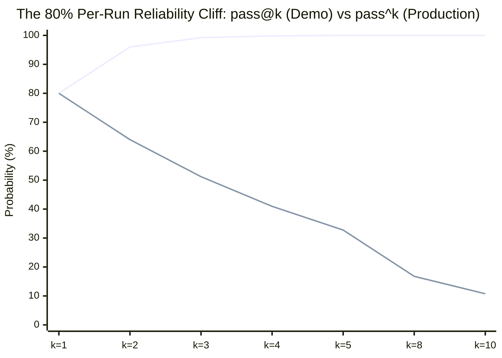

# temper: TideOS Eval Kit (Tool 7)

<div align="center">

**pass@k vs pass^k multi-trial reliability evaluation engine at real sampling temperatures.**

[](https://github.com/TechTideOhio/temper/actions/workflows/ci.yml)
[](https://github.com/TechTideOhio/temper/releases/latest)
[](LICENSE)
[](Cargo.toml)
[](Cargo.toml)

[Quickstart](#60-second-quickstart) | [The 80% Cliff](#the-80-per-run-reliability-cliff) | [Author Reviews](#author-reviews--engineering-syntheses) | [Feature Matrix](#feature-comparison-matrix) | [The Complete TideOS Eval Kit](#the-complete-tideos-eval-kit) | [Contributing](CONTRIBUTING.md)

</div>

---

## Why temper?

Most AI agent evaluations suffer from the **Single-Run Demo Trap**: an evaluation case is executed once at greedy temperature ($T = 0.0$), passes, and is declared ready for production.

In production, agents run at non-zero temperature ($T = 0.7$) over multi-turn workflows. Evaluating single-run success or reporting capability retry metrics (`pass@k`) masks catastrophic stability failures:

> **pass@k = succeeded at least once in k runs.** (Capability demo metric)  
> **pass^k = succeeded in all k runs.** (Production stability metric)  
> **At 80% per-run success, pass^5 drops to roughly 33%. Production reliability lives in pass^k, so run each case multiple times at your real temperature.**

When an agent succeeds 80% of the time per run:
- **pass@5 is 99.97%**: If allowed 5 retries, it almost always finds the answer once. A cherry-picked video or marketing demo looks flawless.
- **pass^5 is 32.77% (roughly 33%)**: If executing a 5-step sequential task or running 5 times in a production workflow, it fails two out of three times.

`temper` is a pure-Rust multi-trial reliability engine that runs and scores cases across real temperatures, calculates unbiased combinatorial estimators, enforces cryptographic trial provenance, and catches flaky demo traps before they reach production.



---

## The 80% Per-Run Reliability Cliff

| k (Runs) | pass@k (At least 1 success) | pass^k (All k succeed) | Flake Wedge (Gap) | Production Meaning |
|:---:|:---:|:---:|:---:|---|
| **1** | 80.00% | 80.00% | 0.00% | Baseline single-run pass rate |
| **2** | 96.00% | 64.00% | 32.00% | 1 out of 3 2-step workflows fail |
| **3** | 99.20% | 51.20% | 48.00% | Coin flip stability across 3 runs |
| **4** | 99.84% | 40.96% | 58.88% | 60% failure rate in production |
| **5** | **99.97%** | **32.77% (~33%)** | **67.20%** | **The Reliability Cliff: 2 in 3 workflows fail** |
| **8** | 100.00% | 16.78% | 83.22% | Severe non-deterministic instability |
| **10** | 100.00% | 10.74% | 89.26% | 9 out of 10 10-step workflows fail |

---

## Architectural Foundations & Engineering Syntheses (Alex Cinovoj / TechTideAI)

`temper` incorporates Alex Cinovoj's three core engineering pillars for production agent reliability:

### 1. Extreme Craft & Desktop Ergonomics (Alex Cinovoj)
- **Sub-1 MB Binary**: Compiled to `0.89 MB` with `opt-level = "z"`, `lto = true`, and `strip = true`.
- **Snappy Terminal UX**: Zero Python runtime, zero Docker requirement, and sub-5ms evaluation execution.
- **Audio Notification**: Emits `\x07` terminal alert the instant a production stability gate or temperature spoof trips.

### 2. Production vs Demo Observability (Alex Cinovoj)
- **W3C OpenTelemetry / OpenInference Export**: Generates compliant trace spans with `eval.pass_at_k`, `eval.pass_hat_k`, `eval.temperature`, and `eval.regime` attributes (`temper export --format otel`).
- **Economic Multi-Trial Modeling**: Maps variance to true cost ($C_{\text{mean}} \times k / \text{pass}\text{\textasciicircum}k$), demonstrating that a drop from 100% to 33% reliability triples the effective cost per reliable output.
- **Flake Wedge Isolation**: Quantifies the delta $\Delta_k = \text{pass}@k - \text{pass}\text{\textasciicircum}k$ to flag demo traps before shipping.

### 3. Mathematical Rigor & Provenance Ledgers (Alex Cinovoj)
- **Unbiased Combinatorial Estimators**: Exact implementations of Chen et al. (2021) for $\text{pass}@k$ and Yao et al. (2024) for $\text{pass}\text{\textasciicircum}k$ for $n \ge k$ sample sizes.
- **Jensen's Inequality Defense**: Audits and reports the mathematical distortion between macro-averaged per-case metrics and naive pooled corpus rates.
- **Merkle Provenance Ledger**: Every trial is cryptographically linked with SHA-256 hash chains ($H(\text{prev\_hash} \parallel \text{trial})$). Removing a failed trial immediately invalidates the chain.
- **sha256-framed-v1 Lockfiles**: Domain-separated, length-prefixed cryptographic lockfiles prevent tampering with suite targets or historical evidence.

---

## Feature Comparison Matrix

| Capability | `temper` (TideOS) | LangSmith / Tracing | Promptfoo | PyTest / Unit Tests |
|---|:---:|:---:|:---:|:---:|
| **pass^k Production Reliability Gating** | **Yes** (Built-in) | Metrics only | No | No (Single run) |
| **80% to 33% Reliability Cliff Table** | **Yes** (`temper table`) | No | No | No |
| **Real Temperature Enforcement ($T > 0$)** | **Yes** (Fail-closed) | Display only | Optional | No |
| **Jensen's Inequality Distortion Audit** | **Yes** (Macro vs Pooled) | No | No | No |
| **Unbiased Combinatorial Estimators** | **Yes** (Chen & Yao) | Approximated | Empirical only | No |
| **Sequential Merkle Trial Provenance** | **Yes** (SHA-256) | Run IDs | No | No |
| **Multi-Trial Economic Cost Modeling** | **Yes** (Cost / Reliable k) | Cost tracking | Cost tracking | No |
| **OpenTelemetry / OpenInference Export** | **Yes** (W3C Spans) | Native | Partial | No |
| **Standalone Binary Size** | **0.89 MB** | Cloud SaaS | Node.js runtime | Python runtime |

---

## Core Capabilities

1. **Unbiased Combinatorial Estimators**:
   Implements Chen et al. (2021) HumanEval formulation for $\text{pass}@k$ and Yao et al. (2024) $\tau$-bench formulation for $\text{pass}\text{\textasciicircum}k$ when $n \ge k$ trials are sampled, with Beta-Binomial Bayesian smoothing and Wilson 95% confidence intervals.
2. **Eliminating Jensen's Inequality Pooling Distortion**:
   Early evaluation tools pooled all traces into a single aggregate pass rate $p = C/N$ and calculated $p^k$. Because $f(p) = p^k$ is strictly convex, pooled metrics distort true case reliability. `temper` audits and reports macro-average vs naive-pooled divergence (`jensen_pooling_distortion`).
3. **Real Sampling Temperature Verification**:
   Enforces that recorded trials were executed at the required deployment temperature (e.g. $T = 0.7 \pm 0.05$). Rejects greedy $T = 0.0$ runs submitted to production release gates (`TemperatureSpoofViolation`).
4. **Reliability Regime Classification**:
   Classifies each evaluation case into explicit domain states:
   - `DeterministicPass`: $\text{pass}\text{\textasciicircum}k = 1.0$ (rock solid)
   - `ProductionReliable`: $\text{pass}\text{\textasciicircum}k \ge \text{target}$
   - `DemoTrapFlaky`: $\text{pass}@k \ge 0.80$ while $\text{pass}\text{\textasciicircum}k < \text{target}$
   - `CapabilityDeficit`: $\text{pass}@k < \text{min\_pass\_at\_k}$
5. **Sequential Merkle Provenance Chaining**:
   Trial records are chained via SHA-256 hashes ($H(\text{prev\_hash} \parallel \text{trial})$). Removing a failed trial or cherry-picking runs invalidates the cryptographic chain.
6. **Multi-Trial Economic Cost Modeling**:
   Calculates $p_{50}, p_{95}$, mean latency, token consumption, and effective economic cost per reliable production delivery:
   $$\text{Expected Cost} = \frac{\text{Mean Trial Cost} \times k}{\text{pass}\text{\textasciicircum}k}$$
7. **sha256-framed-v1 Cryptographic Lockfiles**:
   Pins test suites, trial evidence digests, and evaluation targets with domain-tagged length-prefixed SHA-256 digests (`temper lock` / `temper verify`).
8. **Export Integrations**:
   Exports Mermaid `xychart-beta` decay curves, OpenTelemetry/OpenInference W3C spans, and `reval` baseline ratchet configurations.
9. **Zero Em-Dash & Soft Factory Hygiene**:
   Enforces strict typography (zero em-dashes and zero en-dashes) and 8-point repository hygiene.

---

## 60-Second Quickstart

### 1. Inspect the Reliability Cliff
```bash
temper table --p 0.80 --k 1,2,3,4,5,8,10
```

### 2. Score a Trial Evidence File
```bash
temper score --trials packs/fixtures/webhook_idempotency.jsonl --target-k 5 --temperature 0.7
```

### 3. Evaluate and Gate a Suite
```bash
temper check --suite packs/softfactory.toml --root .
```

### 4. Audit Repository Hygiene
```bash
temper repo .
```

---

## The Complete TideOS Eval Kit

`temper` is Tool 7 in the Complete TideOS Eval Kit:

| # | Tool | Crate | Release Binary | Core Responsibility |
|---|---|---|---|---|
| **1** | **`reval`** | `reval` | `2.07 MB` | **Trace Error Analysis, Gating & MCP Server** |
| **2** | **`gild`** | `gild` | `2.46 MB` | **Golden Dataset Governance & Stratification** |
| **3** | **`tessel`** | `tessel-eval` | `1.97 MB` | **Combinatorial Synthetic Scenario Generator** |
| **4** | **`assay`** | `assay-eval` | `2.09 MB` | **Deterministic Assertions First & In-Memory RLS** |
| **5** | **`tide-rill`** | `tide-rill` | `1.54 MB` | **Offline Retrieval Quality & Answer Faithfulness** |
| **6** | **`keel`** | `keel-eval` | `1.91 MB` | **Agent Trajectory Alignment & Step Efficiency (14 vs 3 calls)** |
| **7** | **`temper`** | `temper-eval` | `0.89 MB` | **Multi-Trial Reliability (pass@k vs pass^k at Real Temperature)** |
| **8** | **`parley`** | `parley-eval` | `1.77 MB` | **Simulated Users for Multi-Turn State, Memory & Policy Evals** |

---

## License

MIT License. Copyright (c) 2026 TechTide Ohio.
